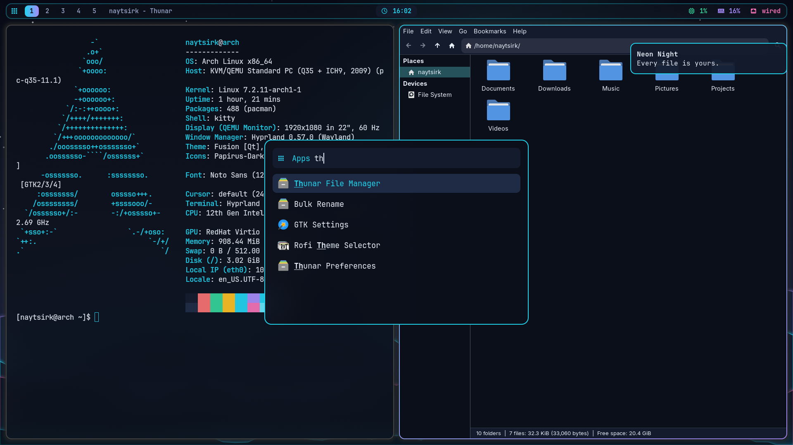

# Neon Night · Hyprland rice



Dotfiles from the video **"Hyprland Rice From Scratch (2026 Beginner Guide)"** by NaytSirk.
Tested on Arch Linux, October 2026: Hyprland 0.57.0 (Lua config), Waybar 0.15.0, rofi 2.0.0, mako 1.11.0,
hyprpaper 0.8.4, kitty 0.49.2, nwg-look 1.2.1, qt6ct 0.11.

## Install

```bash
sudo pacman -S --needed \
  waybar rofi mako libnotify hyprpaper \
  hyprpolkitagent qt6-wayland \
  ttf-jetbrains-mono-nerd noto-fonts-emoji papirus-icon-theme \
  adw-gtk-theme capitaine-cursors nwg-look qt6ct thunar \
  fastfetch btop

# back up what you have first!
cp -r hypr waybar rofi mako kitty gtk-3.0 qt6ct ~/.config/
```

Then log out and back in (the `hyprland.start` autostart and `QT_QPA_PLATFORMTHEME` are read at login).
Open **nwg-look** once and pick `adw-gtk3-dark`, `Papirus-Dark` and `Capitaine Cursors`, then Apply:
on Wayland, GTK reads these from GSettings, and nwg-look writes them there.

## Files

| File | What it does |
|---|---|
| `hypr/hyprland.lua` | Hyprland config (Lua). Monitors, autostart, look and feel, animations, binds |
| `hypr/colors.lua` | The palette, loaded with `require("colors")` |
| `hypr/hyprpaper.conf` | Wallpaper (`splash = false` removes the random quote) |
| `hypr/wallpaper.png` | "Neon Night" wallpaper, made for the video (free to use) |
| `waybar/` | Bar: `config.jsonc` (modules), `style.css` + `colors.css` (look) |
| `rofi/` | Launcher config and theme |
| `mako/config` | Notifications |
| `kitty/kitty.conf` | Terminal: transparency + palette |
| `gtk-3.0/gtk.css` | adw-gtk3 accent and background colors |
| `qt6ct/` | Qt style, color scheme and icons. `qt6ct.conf` has an absolute path to the color scheme: change the user name |

Note: in Hyprland 0.57 the config is `hyprland.lua`. A `hyprland.conf` is only read when no Lua file exists.
